# Intune Visual Doc (`intunedoc`)

[](https://github.com/leifdavisson/intune-visual-doc/actions/workflows/ci.yml)
[](https://www.gnu.org/licenses/agpl-3.0)
[](https://www.python.org/)
[](https://asd-ste100.org/)
[](https://playwright.dev/)
[](https://learn.microsoft.com/en-us/graph/overview)

**Intune Visual Doc** automates documentation for [Microsoft Intune](https://learn.microsoft.com/en-us/mem/intune/) tenants.
It reads configuration data and group assignments through the [Microsoft Graph API](https://learn.microsoft.com/en-us/graph/overview).
Concurrently, it uses [Playwright](https://playwright.dev/) to capture visual screenshots of the **Overview** dashboard and
**Properties** blades directly from the [Microsoft Intune Admin Center](https://intune.microsoft.com).

All generated documentation adheres to the **[ASD-STE100](https://asd-ste100.org/)** standard.
This makes it accessible to both junior support technicians and senior auditors.

---

## Architecture & Workflow

[Open Full Workflow Specification](docs/WORKFLOW.md)

```mermaid
flowchart TD
    subgraph E1["Step 1: Prerequisites & Profile Selection"]
        E1A["1.1 Scan OS and Browsers (Edge, Chrome, Chromium)"]
        E1B["1.2 Parse Local State for User Profiles & Accounts"]
        E1C["1.3 Lock Storage Directory to 0700 Permissions"]
        E1A --> E1B --> E1C
    end

    subgraph E2["Step 2: Tenant Setup (Read-Only Identities)"]
        E2A["2.1 Provision Unattended SPN (intunedoc-reader-spn)"]
        E2B["2.2 Configure Screenshot Account (svc-intunedoc-screenshot)"]
        E2C["2.3 Save Strict Read-Only Credentials to .auth/config.json"]
        E2A --> E2B --> E2C
    end

    subgraph E3["Step 3: Authentication & Token Interception"]
        E3A["3.1 Connect via Unattended SPN or Interactive Hook"]
        E3B["3.2 Intercept Live Graph Bearer Token from Network"]
        E3C["3.3 Capture Portal Session Cookies to .auth/ (0600)"]
        E3A --> E3B --> E3C
    end

    subgraph E4["Step 4: Extraction & Screenshot Capture"]
        E4A["4.1 Extract Policies & Settings Catalog Trees"]
        E4B["4.2 Resolve Entra ID Group IDs to Friendly Names"]
        E4C["4.3 Capture Overview Charts & Properties Blades"]
        E4D["4.4 Query Admin Audit Events for Modification Logs"]
        E4A --> E4B --> E4C --> E4D
    end

    subgraph E5["Step 5: Sanitization & Deliverables Generation"]
        E5A["5.1 Sanitize Secret Keys, Wi-Fi PSKs, Passwords"]
        E5B["5.2 Compute Hygiene Badges (Assigned, Baseline)"]
        E5C["5.3 Render ASD-STE100 Markdown Tree & Raw JSON"]
        E5A --> E5B --> E5C
    end

    subgraph E6["Step 6: Posture Audit, Backup & Safe Restore"]
        E6A["6.1 Run Security Posture Audit (intunedoc audit)"]
        E6B["6.2 Export Fast Raw JSON Backup (intunedoc backup)"]
        E6C["6.3 Audit Configuration Drift (intunedoc diff)"]
        E6D["6.4 Verify ASD-STE100 Compliance (intunedoc lint-ste)"]
        E6E["6.5 Safe Restore Boundary (scripts/intune_restore.py)"]
        E6A --> E6B --> E6C --> E6D --> E6E
    end

    E1C --> E2A
    E2C --> E3A
    E3C --> E4A
    E4D --> E5A
    E5C --> E6A
```



---

## Key Features

1. **Dual Extraction Architecture**:
   - **[Microsoft Graph API](https://learn.microsoft.com/en-us/graph/overview)**: Extracts parameters, flags, registry values, and assignments.
   - **[Playwright](https://playwright.dev/)**: Captures pixel-perfect screenshots of real Intune blades for portal context.
2. **Simplified Technical English ([ASD-STE100](https://asd-ste100.org/))**:
   - Short, active-voice sentences of 25 words or fewer.
   - Exact click paths (`Intune Admin Center > Devices > Configuration profiles > {Policy}`) designed for technicians.
   - Built-in automated validator: `intunedoc lint-ste`.
3. **Audit History & Attributions**:
   - Queries `/deviceManagement/auditEvents` to record who created or updated each policy.
   - Direct links to the [Intune Portal Audit Log](https://intune.microsoft.com/#view/Microsoft_Intune_DeviceSettings/TenantAdminMenuBlade/~/auditLogs).
4. **Policy Health & Hygiene Badges**:
   - 🟢 `Status: Assigned` (Targeted to users or devices)
   - 🟡 `Status: Unassigned / Dormant` (Identifies inactive or orphan policies)
   - 🛡️ `Security Baseline: Recommended` (Highlights BitLocker, Antivirus, and Firewall baselines)
5. **Secure by Default (Secret Sanitization)**:
   - Wi-Fi pre-shared keys, passwords, and private tokens are masked automatically (`[MASKED: ********]`).
   - Run with `--unsanitize` only when explicit auditing is authorized.
6. **Timestamped Deliverables & Historical Catalog**:
   - Snapshots save to `deliverables/<YYYY-MM-DD_HHMMSS>/` with raw JSON and screenshots.
   - Stable `deliverables/latest` symbolic link points to the newest run.
   - Master ledger in `deliverables/README.md` tracks compliance history over time.
7. **Fast Backup & Manifest**:
   - Export raw JSON configurations in seconds with `intunedoc backup`.
   - Generates machine-readable `backup_manifest.json` for disaster recovery.
8. **Standalone Safe Restore Utility**:
   - Isolated script in `scripts/intune_restore.py` outside the read-only TUI.
   - Strips assignments by default to create dormant, unassigned policies.
   - Enforces collision detection, sanitization sentinels, and dry-run execution.
9. **Interactive Terminal User Interface (TUI)**:
   - Built with [Rich](https://github.com/Textualize/rich) and [InquirerPy](https://github.com/kazhala/InquirerPy).
   - Displays live previews of equivalent CLI commands.

---

## Multi-Platform Browser Detection & Credential Security

### 1. Browser & Profile Discovery
The tool scans standard operating system locations to discover Microsoft Edge, Google Chrome, and Chromium profiles:
- **Linux**: `~/.config/microsoft-edge`, `~/.config/google-chrome`, `~/.config/chromium`
- **macOS**: `~/Library/Application Support/Microsoft Edge`, `~/Library/Application Support/Google/Chrome`
- **Windows**: `%LOCALAPPDATA%\Microsoft\Edge\User Data`, `%LOCALAPPDATA%\Google\Chrome\User Data`

It parses `Local State` to display profile names and corporate emails so admins can select their exact account.

### 2. Strict Credential Protection
- **Restricted Permissions**: The `.auth/` directory is locked to `0700` (`rwx------`).
  Token files (`live_token.json`, `playwright_state.json`) use `0600` (`rw-------`) permissions.
- **Git Exclusion**: `.auth/` and session tokens are excluded by `.gitignore`.
- **One-Command Credential Purge**: Run `intunedoc logout` to delete all cached tokens and session cookies.

---

## Quickstart

### 1. Installation

#### Option A: Local Python Virtual Environment

```bash
git clone https://github.com/leifdavisson/intune-visual-doc.git
cd intune-visual-doc

# Set up virtual environment
python3 -m venv .venv
source .venv/bin/activate

# Install dependencies in editable mode
pip install -e ".[dev]"

# Install Playwright browser
playwright install chromium
```

#### Option B: Docker Container (Zero Local Dependencies)

Run without installing Python or browser packages locally:

```bash
# 1. Copy sample environment file and set SPN credentials
cp .env.example .env

# 2. Build and verify offline mock data
docker compose run --rm intunedoc run --mock
docker compose run --rm intunedoc audit --mock

# 3. Run live extraction (mounts ./deliverables and ./.auth)
docker compose run --rm intunedoc run
```

#### Option C: Windows Automated PowerShell Bootstrap

Run on a clean Windows 10/11 workstation to install Git, Python, virtual environment, and Playwright automatically:

```powershell
PowerShell -ExecutionPolicy Bypass -File .\Install-IntuneVisualDoc.ps1
```

### 2. Environment Variables & Authentication

Configure your Service Principal in `.env` or inject variables at runtime:

```bash
AZURE_TENANT_ID=00000000-0000-0000-0000-000000000000
AZURE_CLIENT_ID=00000000-0000-0000-0000-000000000000
AZURE_CLIENT_SECRET=your-spn-client-secret-here
```

Custom path variables:
- `INTUNEDOC_OUTPUT_DIR`: Target deliverables directory (defaults to `deliverables`).
- `INTUNEDOC_AUTH_DIR`: Secure credentials storage path (defaults to `.auth`).

### 3. Interactive Menu (TUI)

Launch the interactive interface with no arguments:

```bash
intunedoc
# or explicitly:
intunedoc tui
```

The menu lets you select categories, toggle screenshots, set audit log retention days, and view the live CLI command.

### 4. Chronological CLI Usage

#### Step 1: Check Prerequisites & Select Profile
```bash
intunedoc check-prereqs
```

#### Step 2: Setup Read-Only Identities
```bash
# Launch interactive identity wizard
intunedoc setup

# Export ready-to-run setup scripts to setup/
intunedoc setup --export-scripts

# Test configured SPN credentials against Microsoft Graph API
intunedoc setup --test-spn
```

Prefer manual portal configuration? See the [Paranoid Administrator Setup Guide](docs/PARANOID_ADMIN_SETUP.md).

#### Step 3: Authenticate & Hook Session
```bash
intunedoc login
```

#### Step 4: Generate Live Documentation
```bash
# Document all policies and audit logs into timestamped deliverables folder
intunedoc run

# Document only compliance policies without screenshots
intunedoc run --category compliance --no-screenshots

# Run offline verification using sample school district data
intunedoc run --mock
```

#### Step 5: Export Fast Configuration Backup
```bash
# Fast backup without screenshots (unmasked for 1-to-1 restore readiness)
intunedoc backup --unsanitize

# Backup specific categories
intunedoc backup --category compliance,configuration
```

#### Step 6: Run Security Posture & Best-Practice Audit
```bash
# Audit tenant security posture against CIS and Microsoft baselines
intunedoc audit

# Generate executive HTML and vector PDF packets for leadership
intunedoc audit --format both

# Audit offline mock data
intunedoc audit --mock

# Audit using strict STIG profile
intunedoc audit --profile strict-stig
```

#### Step 7: Verify ASD-STE100 Language Compliance
```bash
intunedoc lint-ste --directory docs
```

#### Step 8: Compare Configuration Drift
```bash
# Compare live tenant against latest backup
intunedoc diff

# Generate interactive visual drift HTML report
intunedoc diff --html

# Compare two historical backup snapshots offline
intunedoc diff --from deliverables/2026-11-01_100000 --to deliverables/2026-11-01_110000 --html
```

#### Step 9: Multi-Tenant MSP Batch Auditing
```bash
# Audit simulated multi-tenant consortium offline
intunedoc batch --mock

# Generate sample portfolio configuration manifest
intunedoc batch --generate-sample tenants.sample.json

# Audit portfolio of managed tenants with comparative matrix and heatmap
intunedoc batch --config tenants.json --format all
```

#### Step 10: Safe Configuration Restore (Standalone)
```bash
# Simulate restore plan without modifying tenant
python scripts/intune_restore.py --dry-run deliverables/latest/raw_json/compliance/policy.json

# Live restore (creates dormant unassigned policy with safe rename suffix)
python scripts/intune_restore.py deliverables/latest/raw_json/compliance/policy.json
```

#### Step 11: Git-Backed Change Tracking & Emergency Backups
Track tenant drift in a private Git repository and store versioned emergency restore points:
```bash
# 1. Export 1-to-1 unmasked configuration backup
intunedoc backup --unsanitize --output-dir backups

# 2. Commit and push snapshot to your private repository
git add backups/
git commit -m "chore(backup): intune snapshot $(date -u +'%Y-%m-%d %H:%M:%S UTC')"
git push origin main
```

#### Step 12: Logout & Purge Credentials
```bash
intunedoc logout
```

---

## Architecture Decision Records (ADRs)

All design decisions are recorded in standard ADR format using Simplified Technical English:

- [ADR Index: Full Decision Table](docs/adr/README.md)
- [ADR 0001: Record Architecture Decisions](docs/adr/0001-record-architecture-decisions.md)
- [ADR 0002: Dual Authentication and Session Persistence](docs/adr/0002-dual-authentication-and-session-persistence.md)
- [ADR 0003: Data Extraction via Microsoft Graph](docs/adr/0003-data-extraction-via-microsoft-graph.md)
- [ADR 0004: Visual Capture Using Playwright](docs/adr/0004-visual-capture-using-playwright.md)
- [ADR 0005: ASD-STE100 Documentation Standards](docs/adr/0005-asd-ste100-documentation-standards.md)
- [ADR 0006: Security Secret Sanitization by Default](docs/adr/0006-security-secret-sanitization-by-default.md)
- [ADR 0007: Interactive Terminal User Interface](docs/adr/0007-interactive-terminal-user-interface.md)
- [ADR 0008: Browser Detection and Credential Security](docs/adr/0008-browser-detection-and-credential-security.md)
- [ADR 0009: Default Prerequisites and Dependency Gates](docs/adr/0009-default-prerequisites-and-dependency-gates.md)
- [ADR 0010: Agent Documentation and Skill Architecture](docs/adr/0010-agent-documentation-and-skill-architecture.md)
- [ADR 0011: Read-Only Service Principal and Service Account Setup](docs/adr/0011-read-only-spn-and-service-account-setup.md)
- [ADR 0012: Deliverables Folder and Timestamped Runs](docs/adr/0012-deliverables-folder-and-timestamped-runs.md)
- [ADR 0013: Configuration Backups and Safe Restore Utility](docs/adr/0013-configuration-backups-and-safe-restore-utility.md)
- [ADR 0014: Security Posture and Best-Practice Audit Utility](docs/adr/0014-security-posture-and-best-practice-audit-utility.md)
- [ADR 0015: Executive Reporting and Visual Drift Engine](docs/adr/0015-executive-reporting-and-visual-drift-engine.md)
- [ADR 0016: Extended Rule Packs and MSP Batch Automation](docs/adr/0016-extended-rule-packs-and-msp-batch-automation.md)

---

## AI Agent & Skill Guides

- [AGENTS.md: Repository Invariants & Context Pointers](AGENTS.md)
- [SKILL.md: Portable Agent Skill Package](.agents/skills/intune-visual-doc/SKILL.md)

---

## Documentation Links & Project Attribution

- **Microsoft Intune**: [Official Documentation](https://learn.microsoft.com/en-us/mem/intune/) | [Admin Center](https://intune.microsoft.com)
- **Microsoft Graph**: [Graph API Reference](https://learn.microsoft.com/en-us/graph/overview) | [Graph Explorer](https://developer.microsoft.com/en-us/graph/graph-explorer)
- **Microsoft Entra ID**: [App Registration Guide](https://learn.microsoft.com/en-us/entra/identity-platform/quickstart-register-app) | [Graph Permissions Reference](https://learn.microsoft.com/en-us/graph/permissions-reference)
- **Intune RBAC**: [Role-Based Access Control Guide](https://learn.microsoft.com/en-us/mem/intune/fundamentals/role-based-access-control)
- **MSAL Python**: [Microsoft Authentication Library for Python](https://github.com/AzureAD/microsoft-authentication-library-for-python)
- **Playwright**: [Playwright Python Documentation](https://playwright.dev/python/) | [GitHub Repository](https://github.com/microsoft/playwright-python)
- **Rich & InquirerPy**: [Textualize/rich](https://github.com/Textualize/rich) | [InquirerPy](https://github.com/kazhala/InquirerPy)
- **ASD-STE100 Standard**: [Simplified Technical English Maintenance Group (STEMG)](https://asd-ste100.org/)

---

## License

This project is licensed under the **GNU Affero General Public License v3.0 (GNU AGPLv3)**.
See the [LICENSE](LICENSE) file for details.
