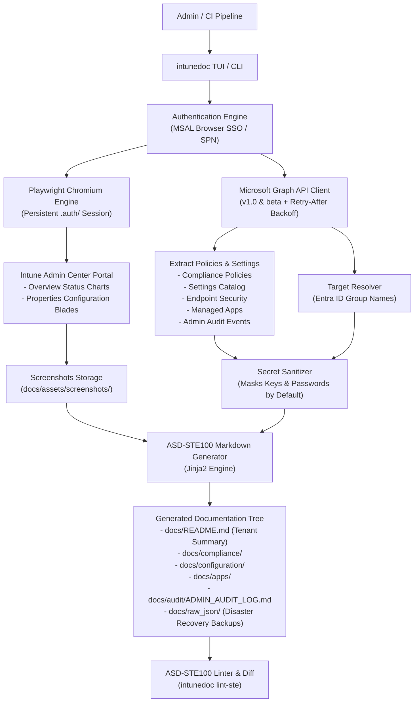

# Intune Visual Doc (`intunedoc`)

[](https://www.gnu.org/licenses/agpl-3.0)
[](https://www.python.org/)
[](https://asd-ste100.org/)
[](https://playwright.dev/)

**Intune Visual Doc** automates the generation of human-readable, screenshot-rich documentation for [Microsoft Intune](https://learn.microsoft.com/en-us/mem/intune/) tenants.
It reads live configuration data, Settings Catalog trees, and group assignments via the [Microsoft Graph API](https://learn.microsoft.com/en-us/graph/overview), while concurrently using [Playwright](https://playwright.dev/) to capture visual screenshots of the **Overview** dashboard and **Properties** blades directly from the [Microsoft Intune Admin Center](https://intune.microsoft.com).

All generated documentation adheres to the **[ASD-STE100 (Simplified Technical English)](https://asd-ste100.org/)** standard, making it accessible to both junior support technicians and senior auditors.

---

## Architecture & Workflow



---

## Key Features

1. **Dual Extraction Architecture**:
   - **Microsoft Graph API**: Extracts structured parameters, boolean flags, registry values, and assignments.
   - **Playwright Chromium**: Captures pixel-perfect screenshots of real Intune blades so technicians have visual context matching their portal screens.
2. **Plain Language (ASD-STE100 Standard)**:
   - Short, active-voice sentences (< 25 words).
   - Click paths (`Intune Admin Center > Devices > Configuration profiles > {Policy}`) designed specifically for Tier-1 technicians.
   - Built-in automated validator: `intunedoc lint-ste`.
3. **Audit History & Attributions**:
   - Queries `/deviceManagement/auditEvents` to record who created or updated each policy.
   - Main documentation stamp shows generation date and includes direct links to the [Intune Portal Audit Log](https://intune.microsoft.com/#view/Microsoft_Intune_DeviceSettings/TenantAdminMenuBlade/~/auditLogs).
4. **Policy Health & Hygiene Badges**:
   - 🟢 `Status: Assigned` (Targeted to users/devices)
   - 🟡 `Status: Unassigned / Dormant` (Identifies inactive or orphan policies)
   - 🛡️ `Security Baseline: Recommended` (Highlights BitLocker, Antivirus, Firewall baselines)
5. **Secure by Default (Secret Sanitization)**:
   - Wi-Fi pre-shared keys, passwords, and private tokens are masked automatically (`[MASKED: ********]`).
   - Run with `--unsanitize` only when explicit auditing is authorized.
6. **Interactive Terminal User Interface (TUI)**:
   - Built with [Rich](https://github.com/Textualize/rich) and [InquirerPy](https://github.com/kazhala/InquirerPy).
   - Displays a live preview of the generated CLI command as options are toggled.

---

## Quickstart

### 1. Installation

```bash
git clone https://github.com/leifdavisson/intune_docs.git
cd intune_docs

# Set up virtual environment
python3 -m venv .venv
source .venv/bin/activate

# Install dependencies and package in editable mode
pip install -e ".[dev]"

# Install Playwright Chromium browser
playwright install chromium
```

### 2. Interactive Menu (TUI)

Launch the interactive interface with no arguments:

```bash
intunedoc
# or explicitly:
intunedoc tui
```

The menu lets you select categories, toggle screenshots, set audit log retention days, and view the live CLI command before executing.

### 3. Direct Command-Line Usage

#### Step 1: Initial Login (Workstation Setup)
Logs in via your browser, completes Entra ID MFA, and saves persistent session state into local `.auth/`:

```bash
intunedoc login
```

#### Step 2: Generate Documentation
Extract live settings, snap portal screenshots, and write Markdown docs:

```bash
# Document all policies and audit logs
intunedoc run

# Document only compliance policies without browser screenshots
intunedoc run --category compliance --no-screenshots

# Run offline verification using sample school district data
intunedoc run --mock
```

#### Step 3: Verify ASD-STE100 Compliance
Run the built-in technical language linter:

```bash
intunedoc lint-ste --directory docs
```

---

## Architecture Decision Records (ADRs)

All design decisions are recorded in standard ADR format using Simplified Technical English:

- [ADR 0001: Record Architecture Decisions](file:///home/leifdavisson/intune_docs/docs/adr/0001-record-architecture-decisions.md) (`file:///home/leifdavisson/intune_docs/docs/adr/0001-record-architecture-decisions.md`)
- [ADR 0002: Dual Authentication and Session Persistence](file:///home/leifdavisson/intune_docs/docs/adr/0002-dual-authentication-and-session-persistence.md) (`file:///home/leifdavisson/intune_docs/docs/adr/0002-dual-authentication-and-session-persistence.md`)
- [ADR 0003: Data Extraction via Microsoft Graph](file:///home/leifdavisson/intune_docs/docs/adr/0003-data-extraction-via-microsoft-graph.md) (`file:///home/leifdavisson/intune_docs/docs/adr/0003-data-extraction-via-microsoft-graph.md`)
- [ADR 0004: Visual Capture Using Playwright](file:///home/leifdavisson/intune_docs/docs/adr/0004-visual-capture-using-playwright.md) (`file:///home/leifdavisson/intune_docs/docs/adr/0004-visual-capture-using-playwright.md`)
- [ADR 0005: ASD-STE100 Documentation Standards](file:///home/leifdavisson/intune_docs/docs/adr/0005-asd-ste100-documentation-standards.md) (`file:///home/leifdavisson/intune_docs/docs/adr/0005-asd-ste100-documentation-standards.md`)
- [ADR 0006: Security Secret Sanitization by Default](file:///home/leifdavisson/intune_docs/docs/adr/0006-security-secret-sanitization-by-default.md) (`file:///home/leifdavisson/intune_docs/docs/adr/0006-security-secret-sanitization-by-default.md`)
- [ADR 0007: Interactive Terminal User Interface](file:///home/leifdavisson/intune_docs/docs/adr/0007-interactive-terminal-user-interface.md) (`file:///home/leifdavisson/intune_docs/docs/adr/0007-interactive-terminal-user-interface.md`)

---

## Documentation Links & Project Attribution

- **Microsoft Intune**: [Official Documentation](https://learn.microsoft.com/en-us/mem/intune/) | [Admin Center](https://intune.microsoft.com)
- **Microsoft Graph**: [Graph API Reference](https://learn.microsoft.com/en-us/graph/overview) | [Graph Explorer](https://developer.microsoft.com/en-us/graph/graph-explorer)
- **MSAL Python**: [Microsoft Authentication Library for Python](https://github.com/AzureAD/microsoft-authentication-library-for-python)
- **Playwright**: [Playwright Python Documentation](https://playwright.dev/python/) | [GitHub Repository](https://github.com/microsoft/playwright-python)
- **Rich & InquirerPy**: [Textualize/rich](https://github.com/Textualize/rich) | [InquirerPy](https://github.com/kazhala/InquirerPy)
- **ASD-STE100 Standard**: [Simplified Technical English Maintenance Group (STEMG)](https://asd-ste100.org/)

---

## License

This project is licensed under the **GNU Affero General Public License v3.0 (GNU AGPLv3)**. See the [LICENSE](file:///home/leifdavisson/intune_docs/LICENSE) (`file:///home/leifdavisson/intune_docs/LICENSE`) file for details.
