# Intune Visual Doc (`intunedoc`)

[](https://www.gnu.org/licenses/agpl-3.0)
[](https://www.python.org/)
[](https://asd-ste100.org/)
[](https://playwright.dev/)

**Intune Visual Doc** automates the generation of human-readable,
screenshot-rich documentation for [Microsoft Intune](https://learn.microsoft.com/en-us/mem/intune/) tenants.
It reads live configuration data, Settings Catalog trees, and group
assignments via the [Microsoft Graph API](https://learn.microsoft.com/en-us/graph/overview), while concurrently
using [Playwright](https://playwright.dev/) to capture visual screenshots of the **Overview** dashboard and
**Properties** blades directly from the [Microsoft Intune Admin Center](https://intune.microsoft.com).

All generated documentation adheres to the **[ASD-STE100](https://asd-ste100.org/)** standard,
making it accessible to both junior support technicians and senior auditors.

---

## Architecture & Workflow

[Open Full Workflow Specification](file:///home/leifdavisson/intune_docs/docs/WORKFLOW.md) (`file:///home/leifdavisson/intune_docs/docs/WORKFLOW.md`)

```mermaid
flowchart TD
    subgraph E1["Step 1: Prerequisites & Profile Selection"]
        E1A["1.1 Scan OS and Browsers (Edge, Chrome, Chromium)"]
        E1B["1.2 Parse Local State for User Profiles & Accounts"]
        E1C["1.3 Lock Storage Directory to 0700 Permissions"]
        E1A --> E1B --> E1C
    end

    subgraph E2["Step 2: Tenant Setup (Read-Only Identities)"]
        E2A["2.1 Provision Unattended SPN (intunedoc-reader-spn)"]
        E2B["2.2 Configure Screenshot Account (svc-intunedoc-screenshot)"]
        E2C["2.3 Save Strict Read-Only Credentials to .auth/config.json"]
        E2A --> E2B --> E2C
    end

    subgraph E3["Step 3: Authentication & Token Interception"]
        E3A["3.1 Connect via Unattended SPN or Interactive Hook"]
        E3B["3.2 Intercept Live Graph Bearer Token from Network"]
        E3C["3.3 Capture Portal Session Cookies to .auth/ (0600)"]
        E3A --> E3B --> E3C
    end

    subgraph E4["Step 4: Extraction & Screenshot Capture"]
        E4A["4.1 Extract Policies & Settings Catalog Trees"]
        E4B["4.2 Resolve Entra ID Group IDs to Friendly Names"]
        E4C["4.3 Capture Overview Charts & Properties Blades"]
        E4D["4.4 Query Admin Audit Events for Modification Logs"]
        E4A --> E4B --> E4C --> E4D
    end

    subgraph E5["Step 5: Sanitization & Document Generation"]
        E5A["5.1 Sanitize Secret Keys, Wi-Fi PSKs, Passwords"]
        E5B["5.2 Compute Hygiene Badges (Assigned, Baseline)"]
        E5C["5.3 Render ASD-STE100 Markdown Tree & Raw JSON"]
        E5A --> E5B --> E5C
    end

    subgraph E6["Step 6: Compliance & Maintenance"]
        E6A["6.1 Run ASD-STE100 Readability & Voice Linter"]
        E6B["6.2 Audit Configuration Drift Against JSON Backups"]
        E6C["6.3 Purge Stored Credentials (intunedoc logout)"]
        E6A --> E6B --> E6C
    end

    E1C --> E2A
    E2C --> E3A
    E3C --> E4A
    E4D --> E5A
    E5C --> E6A
```



---

## Key Features

1. **Dual Extraction Architecture**:
   - **Microsoft Graph API**: Extracts structured parameters, boolean flags, registry values, and assignments.
   - **Playwright Chromium**: Captures pixel-perfect screenshots of real Intune blades so technicians have visual context matching their portal screens.
2. **Plain Language (ASD-STE100 Standard)**:
   - Short, active-voice sentences (< 25 words).
   - Click paths (`Intune Admin Center > Devices > Configuration profiles > {Policy}`) designed specifically for Tier-1 technicians.
   - Built-in automated validator: `intunedoc lint-ste`.
3. **Audit History & Attributions**:
   - Queries `/deviceManagement/auditEvents` to record who created or updated each policy.
   - Main documentation stamp shows generation date and includes direct links to the
     [Intune Portal Audit Log](https://intune.microsoft.com/#view/Microsoft_Intune_DeviceSettings/TenantAdminMenuBlade/~/auditLogs).
4. **Policy Health & Hygiene Badges**:
   - 🟢 `Status: Assigned` (Targeted to users/devices)
   - 🟡 `Status: Unassigned / Dormant` (Identifies inactive or orphan policies)
   - 🛡️ `Security Baseline: Recommended` (Highlights BitLocker, Antivirus, Firewall baselines)
5. **Secure by Default (Secret Sanitization)**:
   - Wi-Fi pre-shared keys, passwords, and private tokens are masked automatically (`[MASKED: ********]`).
   - Run with `--unsanitize` only when explicit auditing is authorized.
6. **Interactive Terminal User Interface (TUI)**:
   - Built with [Rich](https://github.com/Textualize/rich) and [InquirerPy](https://github.com/kazhala/InquirerPy).
   - Displays a live preview of the generated CLI command as options are toggled.
7. **Dedicated Read-Only Identities & Tenant Write Boundary**:
   - `intunedoc setup` is the **ONLY** workflow that makes changes to your tenant (creating App Registrations or guiding service account creation). All other workflows are 100% read-only.
   - **Unattended SPN (`intunedoc-reader-spn`)**: Assigned strictly read-only Graph application permissions (`DeviceManagementConfiguration.Read.All`, `DeviceManagementApps.Read.All`, `DeviceManagementServiceConfig.Read.All`, `Directory.Read.All`, `AuditLog.Read.All`).
   - **Screenshot Maker Account (`svc-intunedoc-screenshot`)**: Dedicated cloud user with Entra role `Directory Readers` and Intune RBAC role `Read Only Operator`.

---

## Multi-Platform Browser Detection & Credential Security

When sharing and deploying `intune-visual-doc` across teams:

### 1. Browser & Profile Discovery
The tool scans standard operating system locations to discover Microsoft Edge, Google Chrome, and Chromium profiles:
- **Linux**: `~/.config/microsoft-edge`, `~/.config/google-chrome`, `~/.config/chromium`
- **macOS**: `~/Library/Application Support/Microsoft Edge`, `~/Library/Application Support/Google/Chrome`
- **Windows**: `%LOCALAPPDATA%\Microsoft\Edge\User Data`, `%LOCALAPPDATA%\Google\Chrome\User Data`

It parses the `Local State` JSON file to display user profile names and corporate email addresses (`user@domain.com`) so admins can select their exact tenant identity before launching.

### 2. Strict Credential Protection
- **Restricted Filesystem Permissions**: The `.auth/` directory is automatically locked to `0700` (`rwx------`).
  All token files (`live_token.json`, `playwright_state.json`) are written with `0600` (`rw-------`) permissions
  so other workstation users cannot read your access tokens.
- **Git Exclusion**: `.auth/` and session tokens are strictly excluded by `.gitignore`.
- **One-Command Credential Purge**: Run `intunedoc logout` or select menu option 6 to instantly delete all cached tokens and session cookies.

---

## Quickstart

### 1. Installation

```bash
git clone https://github.com/leifdavisson/intune_docs.git
cd intune_docs

# Set up virtual environment
python3 -m venv .venv
source .venv/bin/activate

# Install dependencies and package in editable mode
pip install -e ".[dev]"

# Install Playwright Chromium browser
playwright install chromium
```

### 2. Interactive Menu (TUI)

Launch the interactive interface with no arguments:

```bash
intunedoc
# or explicitly:
intunedoc tui
```

The menu lets you select categories, toggle screenshots, set audit log retention days, and view the live CLI command before executing.

### 3. Chronological CLI Usage

#### Step 1: Check Prerequisites & Select Profile
Inspect detected browsers, accounts, and directory security:
```bash
intunedoc check-prereqs
```

#### Step 2: Setup Read-Only Identities (Tenant Setup)
Configure unattended Service Principal or dedicated screenshot maker service account:
```bash
# Launch interactive identity wizard
intunedoc setup

# Export ready-to-run Bash and PowerShell scripts to setup/
intunedoc setup --export-scripts

# Test configured SPN credentials against Microsoft Graph API
intunedoc setup --test-spn
```

#### Step 3: Authenticate & Hook Session
Launches your selected browser profile, navigates to Intune, and captures your live Graph Bearer token:
```bash
intunedoc login
```

#### Step 4: Generate Live Documentation
Extract live settings, snap portal blade screenshots, and render ASD-STE100 Markdown:
```bash
# Document all policies and audit logs
intunedoc run

# Document only compliance policies without screenshots
intunedoc run --category compliance --no-screenshots

# Run offline verification using sample school district data
intunedoc run --mock
```

#### Step 5: Verify ASD-STE100 Language Compliance
Audit generated markdown documents for sentence length and active voice:
```bash
intunedoc lint-ste --directory docs
```

#### Step 6: Audit Configuration Drift
Compare live tenant settings against previous JSON backups:
```bash
intunedoc diff
```

#### Step 7: Logout & Purge Credentials
Wipe all stored tokens, session cookies, and credentials:
```bash
intunedoc logout
```

---

## Architecture Decision Records (ADRs)

All design decisions are recorded in standard ADR format using Simplified Technical English:

- [ADR Index: Full Decision Table](file:///home/leifdavisson/intune_docs/docs/adr/README.md) (`file:///home/leifdavisson/intune_docs/docs/adr/README.md`)
- [ADR 0001: Record Architecture Decisions](file:///home/leifdavisson/intune_docs/docs/adr/0001-record-architecture-decisions.md) (`file:///home/leifdavisson/intune_docs/docs/adr/0001-record-architecture-decisions.md`)
- [ADR 0002: Dual Authentication and Session Persistence](file:///home/leifdavisson/intune_docs/docs/adr/0002-dual-authentication-and-session-persistence.md) (`file:///home/leifdavisson/intune_docs/docs/adr/0002-dual-authentication-and-session-persistence.md`)
- [ADR 0003: Data Extraction via Microsoft Graph](file:///home/leifdavisson/intune_docs/docs/adr/0003-data-extraction-via-microsoft-graph.md) (`file:///home/leifdavisson/intune_docs/docs/adr/0003-data-extraction-via-microsoft-graph.md`)
- [ADR 0004: Visual Capture Using Playwright](file:///home/leifdavisson/intune_docs/docs/adr/0004-visual-capture-using-playwright.md) (`file:///home/leifdavisson/intune_docs/docs/adr/0004-visual-capture-using-playwright.md`)
- [ADR 0005: ASD-STE100 Documentation Standards](file:///home/leifdavisson/intune_docs/docs/adr/0005-asd-ste100-documentation-standards.md) (`file:///home/leifdavisson/intune_docs/docs/adr/0005-asd-ste100-documentation-standards.md`)
- [ADR 0006: Security Secret Sanitization by Default](file:///home/leifdavisson/intune_docs/docs/adr/0006-security-secret-sanitization-by-default.md) (`file:///home/leifdavisson/intune_docs/docs/adr/0006-security-secret-sanitization-by-default.md`)
- [ADR 0007: Interactive Terminal User Interface](file:///home/leifdavisson/intune_docs/docs/adr/0007-interactive-terminal-user-interface.md) (`file:///home/leifdavisson/intune_docs/docs/adr/0007-interactive-terminal-user-interface.md`)
- [ADR 0008: Browser Detection and Credential Security](file:///home/leifdavisson/intune_docs/docs/adr/0008-browser-detection-and-credential-security.md) (`file:///home/leifdavisson/intune_docs/docs/adr/0008-browser-detection-and-credential-security.md`)
- [ADR 0009: Default Prerequisites and Dependency Gates](file:///home/leifdavisson/intune_docs/docs/adr/0009-default-prerequisites-and-dependency-gates.md) (`file:///home/leifdavisson/intune_docs/docs/adr/0009-default-prerequisites-and-dependency-gates.md`)
- [ADR 0010: Agent Documentation and Skill Architecture](file:///home/leifdavisson/intune_docs/docs/adr/0010-agent-documentation-and-skill-architecture.md) (`file:///home/leifdavisson/intune_docs/docs/adr/0010-agent-documentation-and-skill-architecture.md`)
- [ADR 0011: Read-Only Service Principal and Service Account Setup](file:///home/leifdavisson/intune_docs/docs/adr/0011-read-only-spn-and-service-account-setup.md) (`file:///home/leifdavisson/intune_docs/docs/adr/0011-read-only-spn-and-service-account-setup.md`)

---

## AI Agent & Skill Guides

- [AGENTS.md: Repository Invariants & Context Pointers](file:///home/leifdavisson/intune_docs/AGENTS.md) (`file:///home/leifdavisson/intune_docs/AGENTS.md`)
- [SKILL.md: Portable Agent Skill Package](file:///home/leifdavisson/intune_docs/.agents/skills/intune-visual-doc/SKILL.md) (`file:///home/leifdavisson/intune_docs/.agents/skills/intune-visual-doc/SKILL.md`)

---

## Documentation Links & Project Attribution

- **Microsoft Intune**: [Official Documentation](https://learn.microsoft.com/en-us/mem/intune/) | [Admin Center](https://intune.microsoft.com)
- **Microsoft Graph**: [Graph API Reference](https://learn.microsoft.com/en-us/graph/overview) | [Graph Explorer](https://developer.microsoft.com/en-us/graph/graph-explorer)
- **Microsoft Entra ID**: [App Registration Guide](https://learn.microsoft.com/en-us/entra/identity-platform/quickstart-register-app) | [Graph Permissions Reference](https://learn.microsoft.com/en-us/graph/permissions-reference)
- **Intune RBAC**: [Role-Based Access Control Guide](https://learn.microsoft.com/en-us/mem/intune/fundamentals/role-based-access-control)
- **MSAL Python**: [Microsoft Authentication Library for Python](https://github.com/AzureAD/microsoft-authentication-library-for-python)
- **Playwright**: [Playwright Python Documentation](https://playwright.dev/python/) | [GitHub Repository](https://github.com/microsoft/playwright-python)
- **Rich & InquirerPy**: [Textualize/rich](https://github.com/Textualize/rich) | [InquirerPy](https://github.com/kazhala/InquirerPy)
- **ASD-STE100 Standard**: [Simplified Technical English Maintenance Group (STEMG)](https://asd-ste100.org/)

---

## License

This project is licensed under the **GNU Affero General Public License v3.0 (GNU AGPLv3)**. See the [LICENSE](file:///home/leifdavisson/intune_docs/LICENSE) (`file:///home/leifdavisson/intune_docs/LICENSE`) file for details.
