# Intune Visual Doc Workflow Architecture

[Back to Main README](../README.md)

This document outlines the chronological execution workflow for **Intune Visual Doc**.
Every main event and sub-event is ordered in exact operational sequence.

```mermaid
flowchart TD
    subgraph E1["Step 1: Prerequisites & Profile Selection"]
        E1A["1.1 Scan OS and Browsers (Edge, Chrome, Chromium)"]
        E1B["1.2 Parse Local State for User Profiles & Accounts"]
        E1C["1.3 Lock Storage Directory to 0700 Permissions"]
        E1A --> E1B --> E1C
    end

    subgraph E2["Step 2: Authentication & Token Interception"]
        E2A["2.1 Launch Selected Browser Profile via Playwright"]
        E2B["2.2 Intercept Live Graph Bearer Token from Network"]
        E2C["2.3 Capture Portal Session Cookies to .auth/ (0600)"]
        E2A --> E2B --> E2C
    end

    subgraph E3["Step 3: Extraction & Screenshot Capture"]
        E3A["3.1 Extract Policies & Settings Catalog Trees"]
        E3B["3.2 Resolve Entra ID Group IDs to Friendly Names"]
        E3C["3.3 Capture Overview Charts & Properties Blades"]
        E3D["3.4 Query Admin Audit Events for Modification Logs"]
        E3A --> E3B --> E3C --> E3D
    end

    subgraph E4["Step 4: Sanitization & Document Generation"]
        E4A["4.1 Sanitize Secret Keys, Wi-Fi PSKs, Passwords"]
        E4B["4.2 Compute Hygiene Badges (Assigned, Baseline)"]
        E4C["4.3 Render ASD-STE100 Markdown Tree & Raw JSON"]
        E4A --> E4B --> E4C
    end

    subgraph E5["Step 5: Compliance & Maintenance"]
        E5A["5.1 Run ASD-STE100 Readability & Voice Linter"]
        E5B["5.2 Audit Configuration Drift Against JSON Backups"]
        E5C["5.3 Purge Stored Credentials (intunedoc logout)"]
        E5A --> E5B --> E5C
    end

    E1C --> E2A
    E2C --> E3A
    E3D --> E4A
    E4C --> E5A
```

---

## Chronological Event Breakdown

1. **Step 1: Prerequisites & Selection**:
   - Detects all Chromium-based browsers across Linux, macOS, and Windows.
   - Extracts profile directories and corporate emails (`ledavisson@kern.org`).
   - Secures `.auth/` directory with strict `0700` POSIX permissions.
2. **Step 2: Authentication & Session Hook**:
   - Spawns Playwright with your selected browser and profile.
   - Navigates to `intune.microsoft.com` and hooks background network calls.
   - Extracts the active Microsoft Graph Bearer token and closes cleanly.
3. **Step 3: Extraction & Screenshot Capture**:
   - Queries compliance policies, configuration profiles, settings catalog, and apps.
   - Resolves target group GUIDs to display names.
   - Concurrently captures pixel-perfect portal blade screenshots.
   - Extracts administrative audit logs to track who configured each policy.
4. **Step 4: Sanitization & Generation**:
   - Masks sensitive pre-shared keys and secrets by default.
   - Applies hygiene badges (`🟢 Assigned`, `🟡 Dormant`, `🛡️ Baseline`).
   - Renders modular Markdown sheets in ASD-STE100 language.
5. **Step 5: Compliance & Maintenance**:
   - Runs `intunedoc lint-ste` to guarantee standard compliance.
   - Tracks configuration drift with `intunedoc diff`.
   - Offers `intunedoc logout` to wipe all local credentials.

---
*Document standard: [ASD-STE100](https://asd-ste100.org/) | License: [GNU AGPLv3](https://www.gnu.org/licenses/agpl-3.0).*
