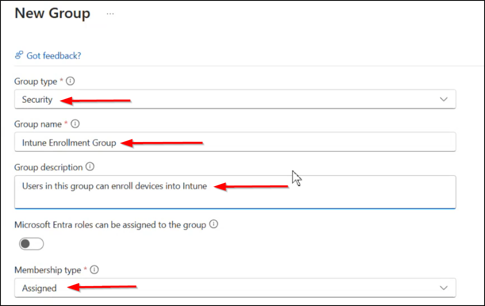
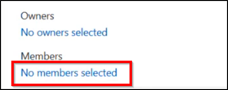

# Company Portal App (Offline)

[All Policies](../../README.md) / [Mobile Application](../README.md) / **Company Portal App (Offline)**

`🟢 Status: Assigned` `💻 Platform: Windows 10/11`

---

## 1. Quick Summary

- **Policy ID**: `a13f60e3-9424-4cd1-d944-61b1b0e6285d`
- **Category**: Mobile Application
- **Description**: Self-service application portal required on all enrolled district endpoints.
- **Created Date**: 2026-06-20T10:00:00Z
- **Last Modified Date**: 2026-09-18T15:30:00Z
- **Last Modified By**: System / Service Principal
- **Reference**: [Microsoft Learn: Manage Apps with Microsoft Intune](https://learn.microsoft.com/en-us/mem/intune/apps/app-management)

### Navigation Path for Technicians
> 📍 **Portal Location**: [Microsoft Intune Admin Center](https://intune.microsoft.com) > **Devices** > **Mobile Application** > **Company Portal App (Offline)**

---

## 2. Visual Reference (Screenshots)

Technicians can compare current portal blades with these screenshots.

### Overview & Assignment Status


*Direct File Link*: [Open Overview Screenshot](file:///home/leifdavisson/intune_docs/docs/assets/screenshots/apps/company-portal-app-offline/overview.png) (`file:///home/leifdavisson/intune_docs/docs/assets/screenshots/apps/company-portal-app-offline/overview.png`)

### Configured Properties Blade


*Direct File Link*: [Open Properties Screenshot](file:///home/leifdavisson/intune_docs/docs/assets/screenshots/apps/company-portal-app-offline/properties.png) (`file:///home/leifdavisson/intune_docs/docs/assets/screenshots/apps/company-portal-app-offline/properties.png`)

---

## 3. Configured Settings

This table lists all parameters set in this policy.

| Setting Name | Configured Value | Status |
| :--- | :--- | :--- |
| `Publisher` | **Microsoft Corporation** | Configured |
| `App Version` | **11.1.1873.0** | Configured |
| `Install Context` | **Device** | Configured |

---

## 4. Assignments & Targeting

This table lists groups included or excluded by this policy.

| Target Name | Target Type | Action |
| :--- | :--- | :--- |
| **Intune_Devices** | Group / Entra ID | `Included` |

---

## 5. Technical Specification (Raw Graph Payload)

<details>
<summary>Click to view raw Microsoft Graph JSON definition</summary>

```json
{
  "id": "[MASKED: a13f...285d]",
  "displayName": "Company Portal App (Offline)",
  "publisher": "Microsoft Corporation"
}
```

</details>

---
*Generated by [intune-visual-doc](https://github.com/leifdavisson/intune_docs) with Microsoft Graph API.*