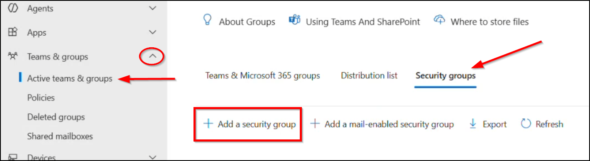
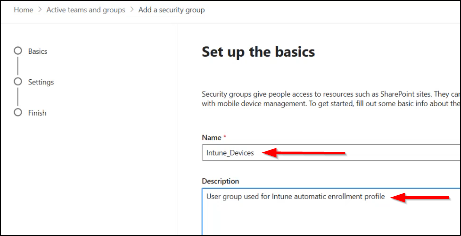

# Staff and Student Device Compliance Policy

[All Policies](../../README.md) / [Device Compliance](../README.md) / **Staff and Student Device Compliance Policy**

`🟢 Status: Assigned` `🛡️ Security Baseline: Recommended` `💻 Platform: Windows 10/11` `👤 Modified By: admin@school.k12.ca.us`

---

## 1. Quick Summary

- **Policy ID**: `e81d48c1-7202-4ab9-b722-49f9f8c4063b`
- **Category**: Device Compliance
- **Description**: Baseline health requirements for Windows devices accessing M365 district resources.
- **Created Date**: 2026-09-01T11:00:00Z
- **Last Modified Date**: 2026-10-20T16:45:10Z
- **Last Modified By**: admin@school.k12.ca.us
- **Reference**: [Microsoft Learn: Device Compliance Policies Overview](https://learn.microsoft.com/en-us/mem/intune/protect/device-compliance-get-started)

### Navigation Path for Technicians
> 📍 **Portal Location**: [Microsoft Intune Admin Center](https://intune.microsoft.com) > **Devices** > **Device Compliance** > **Staff and Student Device Compliance Policy**

---

## 2. Visual Reference (Screenshots)

Technicians can compare current portal blades with these screenshots.

### Overview & Assignment Status


*Direct File Link*: [Open Overview Screenshot](file:///home/leifdavisson/intune_docs/docs/assets/screenshots/compliance/staff-and-student-device-compliance-policy/overview.png) (`file:///home/leifdavisson/intune_docs/docs/assets/screenshots/compliance/staff-and-student-device-compliance-policy/overview.png`)

### Configured Properties Blade


*Direct File Link*: [Open Properties Screenshot](file:///home/leifdavisson/intune_docs/docs/assets/screenshots/compliance/staff-and-student-device-compliance-policy/properties.png) (`file:///home/leifdavisson/intune_docs/docs/assets/screenshots/compliance/staff-and-student-device-compliance-policy/properties.png`)

---

## 3. Configured Settings

This table lists all parameters set in this policy.

| Setting Name | Configured Value | Status |
| :--- | :--- | :--- |
| `osMinimumVersion` | **10.0.22631.3000** | Configured |
| `bitLockerEnabled` | **True** | Configured |
| `firewallEnabled` | **True** | Configured |
| `antivirusEnabled` | **True** | Configured |
| `tpmRequired` | **True (TPM 2.0)** | Configured |
| `passwordMinimumLength` | **[MASKED: ********]** | Configured |

---

## 4. Assignments & Targeting

This table lists groups included or excluded by this policy.

| Target Name | Target Type | Action |
| :--- | :--- | :--- |
| **All Devices** | Group / Entra ID | `Included` |

---

## 5. Technical Specification (Raw Graph Payload)

<details>
<summary>Click to view raw Microsoft Graph JSON definition</summary>

```json
{
  "id": "[MASKED: e81d...063b]",
  "displayName": "Staff and Student Device Compliance Policy",
  "scheduledActionsForRule": [
    {
      "ruleName": "MarkNonCompliant",
      "gracePeriodInHours": 24
    }
  ]
}
```

</details>

---
*Generated by [intune-visual-doc](https://github.com/leifdavisson/intune_docs) with Microsoft Graph API.*