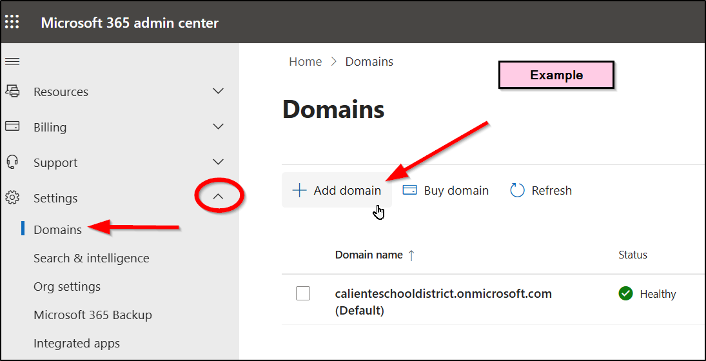
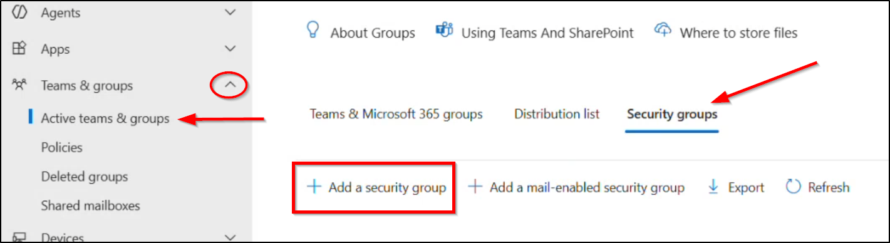

# BitLocker - Windows 11 Enterprise Baseline

[All Policies](../../README.md) / [Settings Catalog](../README.md) / **BitLocker - Windows 11 Enterprise Baseline**

`🟢 Status: Assigned` `🛡️ Security Baseline: Recommended` `💻 Platform: Windows 10/11` `👤 Modified By: leif.davisson@kcsos.org`

---

## 1. Quick Summary

- **Policy ID**: `c71a39f0-6101-49b8-a611-38e8e7b3952a`
- **Category**: Settings Catalog
- **Description**: Enforces XTS-AES 256-bit BitLocker encryption on OS and fixed data drives with Entra ID recovery key backup.
- **Created Date**: 2026-08-15T09:30:00Z
- **Last Modified Date**: 2026-10-12T14:15:22Z
- **Last Modified By**: leif.davisson@kcsos.org
- **Reference**: [Microsoft Learn: BitLocker Policy Management in Intune](https://learn.microsoft.com/en-us/mem/intune/protect/encrypt-devices)

### Navigation Path for Technicians
> 📍 **Portal Location**: [Microsoft Intune Admin Center](https://intune.microsoft.com) > **Devices** > **Settings Catalog** > **BitLocker - Windows 11 Enterprise Baseline**

---

## 2. Visual Reference (Screenshots)

Technicians can compare current portal blades with these screenshots.

### Overview & Assignment Status


*Direct File Link*: [Open Overview Screenshot](file:///home/leifdavisson/intune_docs/docs/assets/screenshots/configuration/bitlocker-windows-11-enterprise-baseline/overview.png) (`file:///home/leifdavisson/intune_docs/docs/assets/screenshots/configuration/bitlocker-windows-11-enterprise-baseline/overview.png`)

### Configured Properties Blade


*Direct File Link*: [Open Properties Screenshot](file:///home/leifdavisson/intune_docs/docs/assets/screenshots/configuration/bitlocker-windows-11-enterprise-baseline/properties.png) (`file:///home/leifdavisson/intune_docs/docs/assets/screenshots/configuration/bitlocker-windows-11-enterprise-baseline/properties.png`)

---

## 3. Configured Settings

This table lists all parameters set in this policy.

| Setting Name | Configured Value | Status |
| :--- | :--- | :--- |
| `RequireDeviceEncryption` | **1 (Enabled)** | Configured |
| `EncryptionMethodWithXtsOs` | **XtsAes256** | Configured |
| `EncryptionMethodWithXtsFdv` | **XtsAes256** | Configured |
| `OsRecoveryKeyBackupToEntraID` | **Allowed** | Configured |
| `RequireStorageCardEncryption` | **1 (Enabled)** | Configured |
| `InternalRecoveryPassphrase` | **[MASKED: ********]** | Configured |

---

## 4. Assignments & Targeting

This table lists groups included or excluded by this policy.

| Target Name | Target Type | Action |
| :--- | :--- | :--- |
| **Intune_Devices** | Group / Entra ID | `Included` |
| **Staff Laptops** | Group / Entra ID | `Included` |
| **Legacy Lab Machines** | Group / Entra ID | `Excluded` |

---

## 5. Technical Specification (Raw Graph Payload)

<details>
<summary>Click to view raw Microsoft Graph JSON definition</summary>

```json
{
  "id": "[MASKED: c71a...952a]",
  "name": "BitLocker - Windows 11 Enterprise Baseline",
  "platforms": "windows11",
  "technologies": "mdm,microsoftSense"
}
```

</details>

---
*Generated by [intune-visual-doc](https://github.com/leifdavisson/intune_docs) with Microsoft Graph API.*