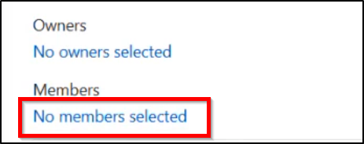
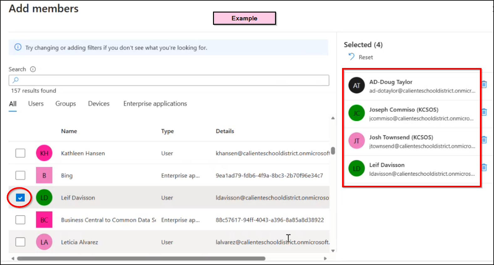

# Draft Lab Kiosk Restrictions (Unassigned)

[All Policies](../../README.md) / [Configuration Template](../README.md) / **Draft Lab Kiosk Restrictions (Unassigned)**

`🟡 Status: Unassigned / Dormant` `💻 Platform: Windows 10/11` `👤 Modified By: leif.davisson@kcsos.org`

---

## 1. Quick Summary

- **Policy ID**: `b24a71f4-0535-4de2-ea55-72c2c1f7396e`
- **Category**: Configuration Template
- **Description**: Experimental multi-app kiosk configuration profile currently undergoing pilot evaluation.
- **Created Date**: 2026-10-25T14:00:00Z
- **Last Modified Date**: 2026-10-28T09:20:00Z
- **Last Modified By**: leif.davisson@kcsos.org
- **Reference**: [Microsoft Learn: Device Configuration and Settings Catalog](https://learn.microsoft.com/en-us/mem/intune/configuration/settings-catalog)

### Navigation Path for Technicians
> 📍 **Portal Location**: [Microsoft Intune Admin Center](https://intune.microsoft.com) > **Devices** > **Configuration Template** > **Draft Lab Kiosk Restrictions (Unassigned)**

---

## 2. Visual Reference (Screenshots)

Technicians can compare current portal blades with these screenshots.

### Overview & Assignment Status


*Direct File Link*: [Open Overview Screenshot](file:///home/leifdavisson/intune_docs/docs/assets/screenshots/configuration/b24a71f4-0535-4de2-ea55-72c2c1f7396e/overview.png) (`file:///home/leifdavisson/intune_docs/docs/assets/screenshots/configuration/b24a71f4-0535-4de2-ea55-72c2c1f7396e/overview.png`)

### Configured Properties Blade


*Direct File Link*: [Open Properties Screenshot](file:///home/leifdavisson/intune_docs/docs/assets/screenshots/configuration/b24a71f4-0535-4de2-ea55-72c2c1f7396e/properties.png) (`file:///home/leifdavisson/intune_docs/docs/assets/screenshots/configuration/b24a71f4-0535-4de2-ea55-72c2c1f7396e/properties.png`)

---

## 3. Configured Settings

This table lists all parameters set in this policy.

| Setting Name | Configured Value | Status |
| :--- | :--- | :--- |
| `KioskMode` | **MultiApp** | Configured |
| `DefaultBrowser` | **MicrosoftEdge** | Configured |

---

## 4. Assignments & Targeting

This table lists groups included or excluded by this policy.

| Target Name | Target Type | Action |
| :--- | :--- | :--- |
| ⚠️ *No assignments found* | *Policy is dormant* | *Unassigned* |

---

## 5. Technical Specification (Raw Graph Payload)

<details>
<summary>Click to view raw Microsoft Graph JSON definition</summary>

```json
{
  "id": "b24a71f4-0535-4de2-ea55-72c2c1f7396e",
  "displayName": "Draft Lab Kiosk Restrictions (Unassigned)"
}
```

</details>

---
*Generated by [intune-visual-doc](https://github.com/leifdavisson/intune_docs) with Microsoft Graph API.*