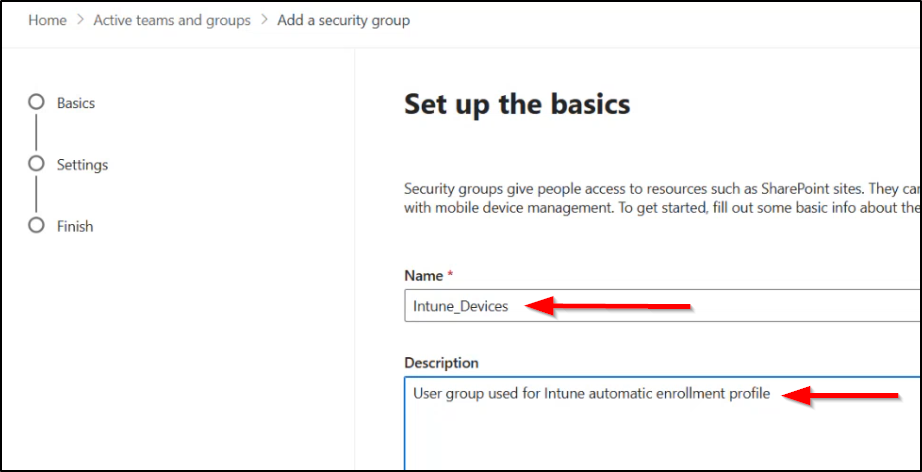
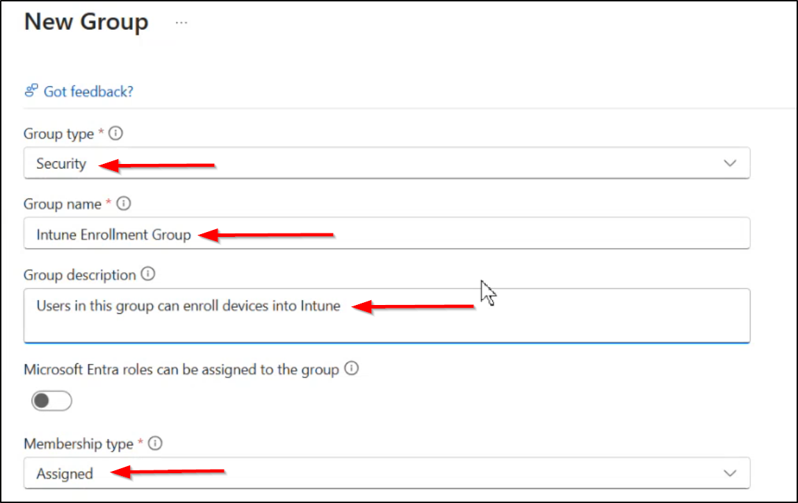

# Windows Autopilot Deployment Profile - District Desktops

[All Policies](../../README.md) / [Enrollment Profile](../README.md) / **Windows Autopilot Deployment Profile - District Desktops**

`🟢 Status: Assigned` `💻 Platform: Windows 10/11` `👤 Modified By: sysadmin@kcsos.org`

---

## 1. Quick Summary

- **Policy ID**: `f92e59d2-8313-4bc0-c833-50a0a9d5174c`
- **Category**: Enrollment Profile
- **Description**: User-driven hybrid Microsoft Entra join enrollment profile for KCSOS district machines.
- **Created Date**: 2026-07-10T08:00:00Z
- **Last Modified Date**: 2026-10-05T12:00:00Z
- **Last Modified By**: sysadmin@kcsos.org
- **Reference**: [Microsoft Learn: Device Configuration and Settings Catalog](https://learn.microsoft.com/en-us/mem/intune/configuration/settings-catalog)

### Navigation Path for Technicians
> 📍 **Portal Location**: [Microsoft Intune Admin Center](https://intune.microsoft.com) > **Devices** > **Enrollment Profile** > **Windows Autopilot Deployment Profile - District Desktops**

---

## 2. Visual Reference (Screenshots)

Technicians can compare current portal blades with these screenshots.

### Overview & Assignment Status


*Direct File Link*: [Open Overview Screenshot](file:///home/leifdavisson/intune_docs/docs/assets/screenshots/configuration/windows-autopilot-deployment-profile-district-desktops/overview.png) (`file:///home/leifdavisson/intune_docs/docs/assets/screenshots/configuration/windows-autopilot-deployment-profile-district-desktops/overview.png`)

### Configured Properties Blade


*Direct File Link*: [Open Properties Screenshot](file:///home/leifdavisson/intune_docs/docs/assets/screenshots/configuration/windows-autopilot-deployment-profile-district-desktops/properties.png) (`file:///home/leifdavisson/intune_docs/docs/assets/screenshots/configuration/windows-autopilot-deployment-profile-district-desktops/properties.png`)

---

## 3. Configured Settings

This table lists all parameters set in this policy.

| Setting Name | Configured Value | Status |
| :--- | :--- | :--- |
| `DeploymentMode` | **UserDriven** | Configured |
| `JoinType` | **AzureADJoined** | Configured |
| `UserAccountType` | **StandardUser** | Configured |
| `HideEULA` | **True** | Configured |
| `HidePrivacySettings` | **True** | Configured |
| `OobeUserSelectLocale` | **False (Auto US-English)** | Configured |

---

## 4. Assignments & Targeting

This table lists groups included or excluded by this policy.

| Target Name | Target Type | Action |
| :--- | :--- | :--- |
| **Intune_Devices** | Group / Entra ID | `Included` |

---

## 5. Technical Specification (Raw Graph Payload)

<details>
<summary>Click to view raw Microsoft Graph JSON definition</summary>

```json
{
  "id": "[MASKED: f92e...174c]",
  "displayName": "Windows Autopilot Deployment Profile - District Desktops"
}
```

</details>

---
*Generated by [intune-visual-doc](https://github.com/leifdavisson/intune_docs) with Microsoft Graph API.*